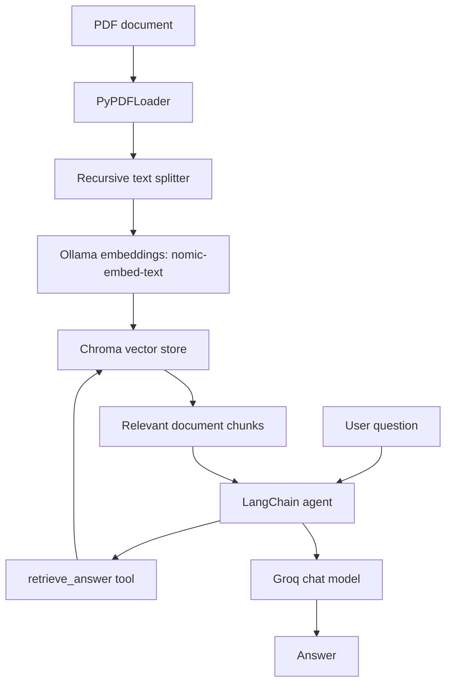

# Agentic RAG — Document Q&A with LangChain, LangGraph & Ollama

An experimental **Agentic Retrieval-Augmented Generation (RAG)** project that lets an AI assistant answer questions using information retrieved from PDF documents. It combines local embeddings from Ollama, Chroma vector search, and a Groq chat model orchestrated with a LangChain agent and LangGraph checkpoint memory.

## Features

- **PDF ingestion:** Load PDF documents with LangChain's `PyPDFLoader`.
- **Text chunking:** Split documents into overlapping chunks for retrieval.
- **Local embeddings:** Generate embeddings with Ollama's `nomic-embed-text` model.
- **Vector storage and retrieval:** Store chunks in Chroma and retrieve relevant passages with similarity search.
- **Tool-enabled agent:** Expose document retrieval as a tool the agent can call to answer questions.
- **Conversation checkpointing:** Use LangGraph's in-memory checkpointer to preserve conversation state within the running Python process.
- **Groq-powered responses:** Use a Groq-hosted chat model to compose answers from retrieved document content.

## How it works

1. Load a PDF and extract its text and page metadata.
2. Split the extracted documents into chunks (`chunk_size=1000`, `chunk_overlap=100`).
3. Embed the chunks locally with `nomic-embed-text`.
4. Store the chunks and embeddings in Chroma.
5. When a question is asked, the agent can call the `retrieve_answer` tool.
6. The tool runs a similarity search and returns relevant document text.
7. The chat model uses the retrieved content to formulate a response.



## Technology stack

- Python 3.11+
- [LangChain](https://www.langchain.com/)
- [LangGraph](https://www.langchain.com/langgraph)
- [Ollama](https://ollama.com/) — local embedding model
- [Chroma](https://www.trychroma.com/) — vector database
- [Groq](https://groq.com/) — chat model API
- [PyPDF](https://pypdf.readthedocs.io/) / `PyPDFLoader`
- Jupyter Notebook
- Streamlit is listed as a dependency, though the included notebook is the current example interface

## Project structure

```text
Agentic-RAG/
├── Data/
│   └── LLM.pdf                 # Example source document
├── notebooks/
│   └── test.ipynb              # End-to-end experimentation notebook
├── RAG /
     └── agent.py # testing the application with groq llms
     └── main.py  # main application with ui           
├── src/
│   └── agentic_rag/
│       └── __init__.py
├── LLM_dictionary.pdf          # Additional PDF resource
├── requirements.txt
├── pyproject.toml
├── .gitignore
└── README.md
```

## Getting started

### 1. Prerequisites

Install:

- Python 3.11 or newer
- [Ollama](https://ollama.com/download)
- A Groq API key

### 2. Clone the repository

```bash
git clone <your-repository-url>
cd Agentic-RAG
```

Replace `<your-repository-url>` with the URL of your GitHub repository.

### 3. Create and activate a virtual environment

**Windows (PowerShell):**

```powershell
py -3.11 -m venv .venv
.venv\Scripts\Activate.ps1
```

**macOS / Linux:**

```bash
python3 -m venv .venv
source .venv/bin/activate
```

### 4. Install dependencies

```bash
python -m pip install --upgrade pip
pip install -r requirements.txt
```

### 5. Download the embedding model

Make sure the Ollama application/service is running, then execute:

```bash
ollama pull nomic-embed-text
```

The notebook currently references `nomic-embed-text:latest`. This model is used for embedding document chunks and user queries, not for generating chat responses.

### 6. Configure the Groq API key

Create a `.env` file in the repository root:

```env
GROQ_API_KEY=your_groq_api_key_here
```

Get an API key from the [Groq Console](https://console.groq.com/keys). Do not commit `.env` or publish your API key. Ensure `.env` is included in `.gitignore`.

### 7. Run the notebook

Start Jupyter:

```bash
jupyter notebook
```

Open `notebooks/test.ipynb` and run the cells in order. Update the PDF path in the notebook to point to a document available on your machine. For example, use a project-relative path such as `Data/LLM.pdf` rather than a hard-coded path from another computer.

## Configuration notes

The notebook currently uses the following settings:

| Component | Current configuration |
|---|---|
| PDF loader | `PyPDFLoader` |
| Chunking | `chunk_size=1000`, `chunk_overlap=100` |
| Embeddings | `OllamaEmbeddings(model="nomic-embed-text:latest")` |
| Vector store | Chroma via `Chroma.from_documents(...)` |
| Retrieval | Similarity search with `k=3` |
| Chat model | `ChatGroq(model="openai/gpt-oss-120b", temperature=0.7)` |
| Agent memory | `InMemorySaver` |

Model availability and API access can change. If the configured Groq model is unavailable to your account, choose a currently supported tool-calling model and update the notebook.

## Important notes and current limitations

- **In-memory checkpointing is temporary.** `InMemorySaver` stores state in process memory; checkpoints are not durable across application restarts.
- **The example retrieval tool returns only the first matching chunk.** For better answers, consider returning several relevant chunks together and preserving their source/page metadata.
- **The notebook uses a local PDF path.** Update it for your machine or use a project-relative path.
- **Chroma persistence is not explicitly configured in the example.** If you want the vector store to survive notebook restarts, configure a persistent directory and reload the collection appropriately.
- **Retrieval is not a guarantee of factual correctness.** Evaluate answers against your source documents and instruct the model to acknowledge when the documents do not contain an answer.
- **The included example is notebook-based.** Although Streamlit appears in `requirements.txt`, a Streamlit UI is not included in the current notebook example.

## Troubleshooting

### Ollama model not found

```bash
ollama pull nomic-embed-text
ollama list
```

### `GROQ_API_KEY` is missing

Check that `.env` is in the working directory from which you start Jupyter, and that it contains `GROQ_API_KEY=...`. Restart the kernel after changing environment variables if needed.

### `NameError: name 'Chroma' is not defined`

Install the integration and import the class:

```bash
pip install -U langchain-chroma
```

```python
from langchain_chroma import Chroma
```

### PDF file not found

Use a valid path to the PDF. If you launch Jupyter from the repository root, the sample file can be referenced as `Data/LLM.pdf`.

### Retrieval returns irrelevant content

Try adjusting chunk size and overlap, increase `k`, and evaluate retrieved chunks before passing them to the model. Use the same embedding model when indexing documents and embedding queries.

## Future improvements

- Add a Streamlit chat interface.
- Return multiple relevant chunks with page citations.
- Add persistent Chroma storage.
- Add source-grounded answer instructions and a fallback when no relevant evidence is found.
- Add tests for document loading, retrieval quality, tool invocation, and response accuracy.
- Add configurable PDF uploads and support for multiple documents.

## Contributing

Contributions and suggestions are welcome. You can open an issue to report a bug or propose an improvement, or submit a pull request with a clear description of the change.

## Security

Never commit API keys, tokens, or other secrets. Keep credentials in environment variables or a local `.env` file and make sure that file is ignored by Git.

## License

No license is specified in the repository yet. Add a `LICENSE` file before explicitly granting others permission to reuse or redistribute the project.

---

**Built as a hands-on project to explore agentic RAG, local embeddings, vector search, and tool-using LLM agents.**
